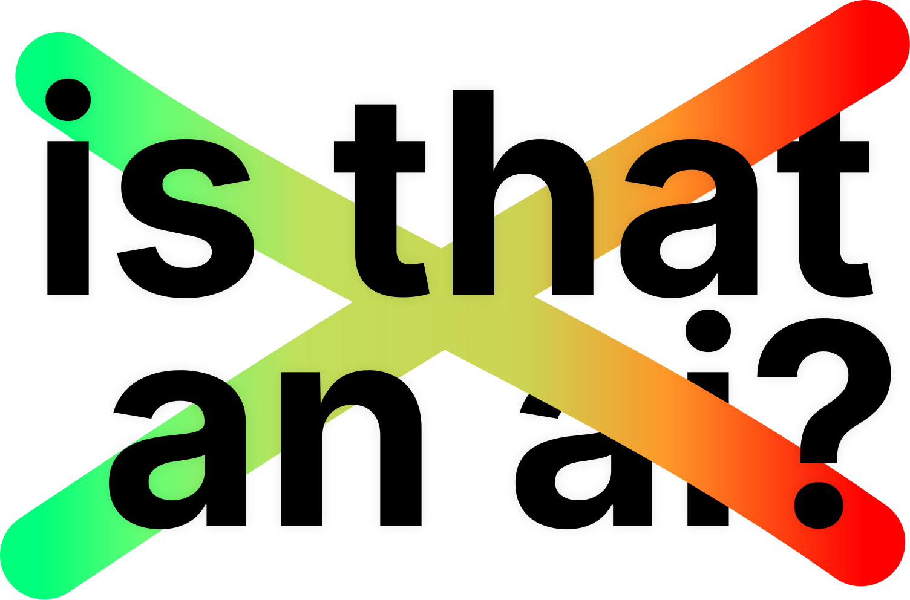

<div align="center">



### A finished, privacy-first browser detector for human vs. agent behaviour

[](./LICENSE)
[](./packages/is-that-an-ai/package.json)
[](./REAL_WORLD_AUDIT.md)
[](./CHECKLIST_STATUS.md)
[](#internationalization)

**Numeric signals only · No network · No storage · SSR-safe · 12 languages · v0.1.0**

[Live demo](https://nooberdev.github.io/isthatanai/) ·
[Documentation](https://nooberdev.github.io/isthatanai/docs/) ·
[Real-world audit](./REAL_WORLD_AUDIT.md) ·
[Lab report](./LAB_REPORT.md) ·
[Threat model](./SECURITY.md)

</div>

---

## What it is

`is-that-an-ai` is a client-side behavioural detector. It listens to the way a
person (or an automated agent) uses a page — pointer movement, clicks, scrolling,
keyboard rhythm, touch gestures and attention events — and turns those timings
into a single score from `0` (human) to `1` (agent).

It is built for the browser and designed around three non-negotiables:

1. **Privacy by construction.** No `fetch`, XHR or WebSocket. No `localStorage`,
   `sessionStorage` or cookies. No key identities, no typed text, no clipboard
   data. Only numbers: timestamps, coordinates, categories and counts.
2. **Fail closed.** Without sufficient evidence the verdict is `measuring`, never
   `human`. A missing signal is not a clearance.
3. **Honest limits.** The code runs in the user's browser. A script with access to
   the page can patch it. The detector makes evasion expensive; it does not claim
   to make it impossible. The accepted limits are written down in
   [SECURITY.md](./SECURITY.md).

The library is the result of a ten-stage build: real collectors, ten calibrated
mouse measures, click and scroll signals, keyboard rhythm and paste detection,
an EMA scoring engine with hysteresis, a lab with simulated attack profiles,
device profiles — including Android TV remotes — anti-tamper guardrails, a
complete API, twelve locales and a packaged v0.1.0 release.

---

## Contents

- [Highlights](#highlights)
- [Install](#install)
- [Quick start](#quick-start)
- [Verdicts and thresholds](#verdicts-and-thresholds)
- [Configuration](#configuration)
- [Signals](#signals)
- [Scoring model](#scoring-model)
- [Calibration](#calibration)
- [Device profiles](#device-profiles)
- [Security and guardrails](#security-and-guardrails)
- [Privacy](#privacy)
- [Internationalization](#internationalization)
- [API reference](#api-reference)
- [Framework adapters](#framework-adapters)
- [Script tag and global mode](#script-tag-and-global-mode)
- [Performance](#performance)
- [Project layout](#project-layout)
- [Validation](#validation)
- [Frequently asked questions](#frequently-asked-questions)
- [License](#license)

---

## Highlights

- **Six signal families** — mouse, click, scroll, keyboard, touch and attention —
  with 205 discrete measures and behaviours covered by tests.
- **Calibrated on a real human session.** The human keyboard baseline scores
  **0.038** against a `HUMAN_MAX` of `0.25`; the reference bot scores **0.786**.
- **Fast first verdict.** With continuous pointer activity, a human verdict can
  appear in about **800 ms**; a fast, regular typing bot in about **700 ms**. A
  normal human typing session needs roughly **3.7 s** to gather enough evidence.
- **Advanced measures are opt-in.** `advancedMeasures: true` enables the full
  measurement set with a bounded combined share of `0.15`; the validated default
  calibration is never disturbed.
- **Anti-tamper without secrecy.** Cross-signal coherence, injected-event
  detection, humanization detection, formula-rhythm detection, replay tracking,
  runtime integrity checks, liveness and deterministic weight jitter are all
  implemented in plain, public code.
- **Twelve locales** with automatic system-language detection and English
  fallback: `en, es, fr, de, pt, it, nl, sv, pl, ja, ko, zh`.
- **Small, predictable runtime.** No dependency on a framework, no polyfills, no
  background workers.

---

## Install

The package is published as an ESM module with TypeScript declarations and a
minified IIFE build for plain HTML pages.

```sh
bun add is-that-an-ai
```

```ts
import { IsThatAnAI } from "is-that-an-ai";
```

Package entry points:

| Entry      | File                  | Use                                                         |
| ---------- | --------------------- | ----------------------------------------------------------- |
| `.`        | `dist/index.js`       | ESM, types in `dist/index.d.ts`                             |
| `./iife`   | `dist/index.iife.js`  | `<script>` global `IsThatAnAI`                              |
| `./global` | `dist/global.iife.js` | `<script>` global `IsThatAnAIGlobal` with `installGlobal()` |

Build from source with:

```sh
bun install
bun run build
```

---

## Quick start

```ts
import { IsThatAnAI } from "is-that-an-ai";

const detector = new IsThatAnAI({ locale: "auto" });

detector.onVerdict((verdict) => {
  console.log(verdict.state, verdict.score, verdict.reasons);
});

detector.start();

// Later, when the view is destroyed:
detector.stop();
```

The detector resolves the locale when `start()` is called, so importing the
module is safe during server-side rendering. Collectors are attached inside
`start()` and removed in `stop()`.

A verdict looks like this:

```ts
{
  state: "human",          // "measuring" | "human" | "ai"
  score: 0.038,            // number | null, 0 = human, 1 = agent
  confidence: 0.92,
  doubt: 0.0,
  reasons: []              // localized, top contributors
}
```

---

## Verdicts and thresholds

The score is a weighted combination of the signals that currently have enough
evidence. Signals without evidence are excluded from both the numerator and the
confidence calculation.

| Constant            |  Default | Meaning                                               |
| ------------------- | -------: | ----------------------------------------------------- |
| `HUMAN_MAX`         |   `0.25` | Score at or below this is human.                      |
| `AI_MIN`            |   `0.55` | Score at or above this is an agent.                   |
| `HUMAN_CORE`        |   `0.15` | Center of the human class, used for doubt.            |
| `AI_CORE`           |   `0.85` | Center of the agent class, used for doubt.            |
| EMA alpha           |   `0.35` | Smoothing between evaluations.                        |
| Evaluation interval | `100 ms` | How often the scorer runs.                            |
| Human confirmation  | `250 ms` | Sample-time needed to leave `measuring` toward human. |
| Agent confirmation  | `600 ms` | Sample-time needed to enter the `ai` state.           |

The band between `0.25` and `0.55` is deliberately unresolved: arriving there
from `measuring` resolves to human after the human confirmation period — the
benefit of the doubt — while an existing verdict is preserved until evidence
crosses a class boundary. Confirmation uses the timestamps of the samples, not
the wall clock: if the user stops generating events, the pending transition does
not complete.

---

## Configuration

All options are optional. Defaults preserve the validated calibration.

```ts
const detector = new IsThatAnAI({
  signals: ["mouse", "click", "scroll", "keyboard"],
  device: "auto",
  sensitivity: "normal",
  accessibility: false,
  locale: "auto",
  antiCheat: true,
  antiCheatWeightJitter: true,
  advancedMeasures: false,
  aggregatesOnly: false,
  debug: false,
  customEvent: false,
  mouse: { bufferSize: 400, maxAgeMs: 4000 },
});
```

| Option                  | Default               | Description                                                                                          |
| ----------------------- | --------------------- | ---------------------------------------------------------------------------------------------------- |
| `signals`               | all four core signals | Signals allowed to contribute. Re-filterable at runtime with `enableSignals()` / `disableSignals()`. |
| `device`                | `"auto"`              | `"auto"`, `"desktop"`, `"touch"`, `"tv"` or a detailed device name. Drives TV D-pad handling.        |
| `sensitivity`           | `"normal"`            | `"estricto"`, `"normal"` or `"relajado"`. Applies a threshold and confirmation preset.               |
| `accessibility`         | `false`               | `true`, `false` or `"auto"`. Never treats a missing mouse as suspicious.                             |
| `locale`                | `"auto"`              | One of the twelve locales, or system detection.                                                      |
| `antiCheat`             | `true`                | Adds guardrail evidence without changing the calibrated numeric score.                               |
| `antiCheatWeightJitter` | `true`                | Deterministic, non-secret per-session signal-weight jitter after 12 evaluations.                     |
| `advancedMeasures`      | `false`               | Opt-in final measurement lane with a bounded `0.15` share.                                           |
| `aggregatesOnly`        | `false`               | Exposes only counts and rounded timing aggregates. DNT can force this on.                            |
| `debug`                 | `false`               | Emits concise `console.debug` lines from `evaluate()`.                                               |
| `customEvent`           | `false`               | Dispatches `CustomEvent("isthatanai")` on `document` on state changes.                               |
| `mouse.bufferSize`      | `2048`                | Ring-buffer capacity for pointer samples. Clamped to `1..100000`.                                    |
| `mouse.maxAgeMs`        | `15000`               | Maximum sample age. Clamped to safe bounds.                                                          |

Configuration can be changed at runtime:

```ts
detector.configure({
  sensitivity: "estricto",
  locale: "fr",
  advancedMeasures: true,
});
```

Explicit values in the same `configure()` call override values coming from a
sensitivity preset. Invalid, inherited or hostile properties are ignored.

---

## Signals

### Mouse

Trajectory efficiency, turn smoothness, teleport detection, speed uniformity,
jerk, tremor, interval regularity, overshoot, micro-pauses, round steps and the
extended lane: symmetry, perfect curves, favourite directions, movement origin,
thinking drift, maximum speed, initial acceleration, final braking,
speed-by-distance, still-before-move, rest stability, post-release drift,
Fitts-law timing, aim time, time-to-click, route to target, anticipation and
hover behaviour. All measures are pure functions over numeric samples.

### Click and scroll

Click duration regularity, interval regularity, burstiness, down/up drift,
button usage, aim consistency, double-click rhythm, secondary buttons and drag
behaviour. Scroll measures cover delta uniformity, interval regularity,
direction changes, deceleration, reading pauses, round deltas, axis lock and
large jumps. Autoscroll is excluded before evidence is counted.

### Keyboard

Inter-key timing, hold regularity, correction bursts, paste ratio, text without
keydown, modifier shortcuts, pauses, exact rhythm and the extended rhythm and
behaviour lane: key overlap, letter pairs, hand-switch proxy, repeated key,
warm-up, first-key pause, rhythm by text length, zero-errors-in-long-text and Tab
usage. Key strings are consumed by the collector and discarded; only numeric
categories are stored.

### Touch and attention

The touch collector listens to pointer events from touch/pen devices and records
pressure, contact area, orientation, timing and trust. Eleven measures cover
duration, inertia, multi-touch, pinch, tap-versus-click and tremor proxies. The
attention collector observes visibility, focus, resize and idle transitions and
feeds eleven measures about tab switches, backgrounding, reading time, reaction
time and long pauses.

Both families are optional: pass `touch: {}` or `attention: {}` to construct and
attach their collectors. Their weights are zero by default and are activated only
through `advancedMeasures`.

### Coherence and environment

Nine extra guardrails look for contradictions between channels (mouse/keyboard
overlap, clicks before typing, pointer before action, temporal consistency,
session variety, action order) and for environment markers (automated browser,
odd viewport, lack of movement, lack of normal events, agent tools). Environment
hints are injected by the detector at runtime; no module reads `navigator` at
import time.

---

## Scoring model

Each feature returns a number in `[0,1]`, where `1` means "more agent-like".
Some mouse features are inverted because smoothness and overshoot are human
traits. The weighted average is normalized over the weights actually used, then
smoothed with an EMA. Confidence combines the amount of evidence with the time
span covered by the samples.

`ScoreComputer` can be configured directly:

```ts
import { ScoreComputer, SENSITIVITY_PRESETS } from "is-that-an-ai";

const scorer = new ScoreComputer();
scorer.configure({
  combination: "adaptive",
  signalWeights: { mouse: 0.6, click: 0.2, scroll: 0.2, keyboard: 0.15 },
  emaAlpha: 0.35,
  antiCheat: true,
  jitterSeed: 12345,
});

const evidence = scorer.evaluate(points, windowMs, clicks, scrolls, keys, inputs);
console.log(evidence.score, evidence.confidence, evidence.reasons);
```

`adaptive` combination gives extra weight to signals that are harder to fake
(mouse and keyboard). `getScoreBreakdown()` exposes effective weights, EMA state,
per-signal scores, risk evidence and notes without changing the verdict object's
enumerable shape.

---

## Calibration

The human baseline comes from a recorded session: 45.44 WPM, 96.07% accuracy,
keydown intervals centred around 189 ms, holds around 94 ms and natural pauses
of one to eight seconds. That session scores **0.038**. The same scorer classifies
a 7 ms fixed-cadence bot at **0.786**.

A recorded session can be used to refine the detector in memory:

```ts
const result = detector.recalibrateFromSession(recordedSession);
console.log(result.applied, result.samples, result.adjustments, result.reasons);
```

- Adjustments are robust-median based and limited to **±20%**.
- Absolute thresholds are clamped to safe ranges.
- Calibration affects guardrail tolerance only — never evidence gates or verdict
  thresholds.
- Nothing is stored and no verdict can be forced to `human`.
- `resetCalibration()` returns to the validated baseline.

The full lab methodology and its honest false negatives are documented in
[LAB_REPORT.md](./LAB_REPORT.md).

---

## Device profiles

`device: "auto"` infers the interaction style from the numeric stream. A TV
remote produces arrow/Enter/Escape key categories and no pointer or text input;
the detector recognizes that shape and neutralizes rhythm measures that would
otherwise punish D-pad cadence. A sustained 60 ms arrow bot is still detected —
TV mode is not a human bypass.

`getDeviceProfile()` returns the coarse profile (`desktop`, `touch`, `tv`) and
`getDetailedDevice()` returns `computadora`, `laptop`, `celular`, `tablet`, `tv`
or `touch`. The detailed profile is inferred at `start()` from runtime hints such
as `maxTouchPoints`, UA data and screen width, and refined from the numeric
stream during evaluation.

---

## Security and guardrails

- **Fail closed** on missing evidence and on failed integrity checks.
- **Injected events**: untrusted flags combined with implausible timing precision.
- **Humanization**: AR(1)-style autocorrelation, heavy-tail and CV analysis, plus
  cycle detection from 2 to 8 periods.
- **Formula rhythm**: repeated exact intervals and low-jitter periodic patterns.
- **Replay**: identical numeric trajectories repeated inside the same session.
- **Surprise checks**: contradictory class verdicts between evidenced signals.
- **Integrity**: API surface, frozen weights, sane thresholds and a usable clock.
- **Liveness**: `getLiveness()` and `onLiveness()` let a host page notice if the
  detector stops beating. Liveness never changes a verdict.

The explicit limitations — real browser-controlled agents, cross-session replay,
server-side verification and public-code evasion — are listed in
[SECURITY.md](./SECURITY.md).

---

## Privacy

| Rule              | Implementation                                                                          |
| ----------------- | --------------------------------------------------------------------------------------- |
| No network        | No `fetch`, XHR, WebSocket or beacons anywhere in the library.                          |
| No persistence    | No `localStorage`, `sessionStorage`, cookies or IndexedDB.                              |
| No key identities | Key strings are read in the listener and discarded; only numeric categories are stored. |
| No text           | `inputType` metadata is used; `data` and clipboard contents are never read.             |
| Password fields   | Skipped without reading their value.                                                    |
| SSR safe          | No `window`, `document` or `navigator` access at import or in the constructor.          |
| Aggregates mode   | `aggregatesOnly: true` (or DNT) exposes only counts and rounded timing aggregates.      |

---

## Internationalization

Twelve locales are shipped as static dictionaries:

`en` · `es` · `fr` · `de` · `pt` · `it` · `nl` · `sv` · `pl` · `ja` · `ko` · `zh`

```ts
import { detectLocale, LOCALES, t } from "is-that-an-ai";

detectLocale("zh-TW"); // "zh"
t("reason.mouse.teleport", "de"); // localized reason
```

`detectLocale()` reads `navigator.language` only when called at runtime and falls
back to English for unknown tags. Verdict reasons are translated through the
same dictionaries, including security reasons added by the guardrails.

---

## API reference

### Lifecycle

| Method                                 | Returns                     | Description                                                         |
| -------------------------------------- | --------------------------- | ------------------------------------------------------------------- |
| `start()`                              | `void`                      | Attach collectors and begin the 100 ms evaluation loop. Idempotent. |
| `stop()`                               | `void`                      | Stop the loop, detach and clear collectors, reset state.            |
| `pause()` / `resume()` / `getPaused()` | `void` / `void` / `boolean` | Freeze evaluation while keeping listeners attached.                 |
| `reset()`                              | `void`                      | Clear buffers, scores, verdict, replay history and calibration.     |
| `configure(options)`                   | `void`                      | Merge configuration safely.                                         |
| `attachTo(target)`                     | `void`                      | Bind collectors to a specific `EventTarget`.                        |

### Observability

| Method                                                                                                                                            | Description                                                         |
| ------------------------------------------------------------------------------------------------------------------------------------------------- | ------------------------------------------------------------------- |
| `getVerdict()`                                                                                                                                    | Copy of the current verdict.                                        |
| `onVerdict(cb)`                                                                                                                                   | Subscribe to state changes; returns an unsubscribe function.        |
| `onChange(cb)`                                                                                                                                    | Subscribe only to human↔AI changes.                                 |
| `onThreshold(value, cb)`                                                                                                                          | Subscribe to score crossings of a threshold in `[0,1]`.             |
| `getSignalScores()`                                                                                                                               | Per-signal scores; unavailable signals are `null`.                  |
| `getScoreBreakdown()`                                                                                                                             | Weights, effective weights, EMA, risk evidence, notes and handover. |
| `getReasons()`                                                                                                                                    | Localized reasons from the current verdict.                         |
| `getStats()`                                                                                                                                      | Buffer and event counters, with optional touch/attention counts.    |
| `getMouseFeatures()`                                                                                                                              | Latest mouse feature vector.                                        |
| `getTouchFeatures()` / `getAttentionFeatures()`                                                                                                   | Latest optional feature vectors.                                    |
| `getRecentPoints`, `getRecentClicks`, `getRecentScrolls`, `getRecentKeys`, `getRecentInputs`, `getRecentTouches`, `getRecentAttention(sinceSeq?)` | Numeric sample snapshots.                                           |
| `getDeviceProfile()` / `getDetailedDevice()`                                                                                                      | Coarse and detailed device profile.                                 |
| `getSensitivity()` / `getAccessibility()` / `getPrivacyMode()`                                                                                    | Effective mode getters.                                             |
| `getLiveness(now?)` / `onLiveness(cb)`                                                                                                            | Liveness status and subscription.                                   |
| `getIntegrity()`                                                                                                                                  | Runtime integrity report.                                           |
| `getReplaySignals()` / `getSurpriseCheck()`                                                                                                       | Guardrail observations.                                             |
| `getCalibration()` / `resetCalibration()` / `recalibrateFromSession(session)`                                                                     | Bounded in-memory calibration.                                      |
| `enableSignals(list)` / `disableSignals(list)` / `getEnabledSignals()`                                                                            | Runtime signal filtering.                                           |
| `setDebug(bool)` / `isDebug()`                                                                                                                    | Console debug mode.                                                 |

### Standalone helpers

`autoStart(options?)`, `installGlobal(name?)`, `computeScore(features)`,
`ScoreComputer`, `detectLocale()`, `t()`, `inferDeviceProfile()`,
`inferDetailedDevice()`, `evaluateCoherence()`,
`evaluateCoherenceDetailed()`, `evaluateEnvironment()`, `injectionRisk()`,
`humanizationRisk()`, `noiseHumanity()`, `formulaRhythm()`, `detectReplay()`,
`ReplayTracker`, `verifyIntegrity()`, `LivenessMonitor`,
`surpriseCoherenceCheck()`, `privacyAudit()`, `PRIVACY_NOTICE`,
`calibrationFromSession()` and `applyCalibration()` are exported for advanced
integrations.

---

## Framework adapters

The package contains dependency-free lifecycle adapters. They are small by
design: the host component decides when to start and stop.

```ts
import { createReactDetector, createSvelteDetector, createVueDetector } from "is-that-an-ai";

const react = createReactDetector({ locale: "auto" });
// useEffect(() => { react.start(); return () => react.stop(); }, []);

const svelte = createSvelteDetector();
// onMount(() => { svelte.start(); return () => svelte.stop(); });

const vue = createVueDetector();
// onMounted(() => vue.start()); onUnmounted(() => vue.stop());
```

---

## Script tag and global mode

The IIFE bundle assigns its exports to a real global. Bun 1.4 ignores
`--global-name` for IIFE output, so the bundle uses an explicit entry that
performs the assignment.

```html
<script src="dist/index.iife.js"></script>
<script>
  const detector = new IsThatAnAI.IsThatAnAI();
  detector.start();
</script>
```

For a global installer:

```html
<script src="dist/global.iife.js"></script>
<script>
  const detector = IsThatAnAIGlobal.installGlobal(); // window.isThatAnAI
  detector.start();
</script>
```

A complete example lives in [`examples/script-tag.html`](./examples/script-tag.html).

---

## Performance

The library is pure TypeScript with no runtime dependencies. The measured
bundle sizes with all twelve locales and the full guardrail set are:

| Build           |               Size |
| --------------- | -----------------: |
| IIFE, minified  |          200.61 KB |
| ESM, unminified |          351.83 KB |
| Declarations    | generated by `tsc` |

The demo shares one 160 ms ticker for all live views, reuses canvas objects,
and writes cursor transforms directly to the DOM. It compiles to a static site
with no API calls and no persistent storage.

---

## Project layout

```text
.
├── apps/demo/                  SvelteKit demo, docs page and 12-locale UI
├── examples/script-tag.html    Plain HTML integration example
├── packages/is-that-an-ai/
│   ├── src/
│   │   ├── calibration/        Human baseline and bounded recalibration
│   │   ├── collectors/         Pointer, click, scroll, keyboard, text, touch, attention
│   │   ├── core/               Detector, coherence, environment, guardrails
│   │   ├── features/           Pure numeric measures for every signal
│   │   ├── frameworks/         React/Svelte/Vue lifecycle adapters
│   │   ├── i18n/               12 dictionaries and reason translation
│   │   ├── scoring/            Weights, combination and guardrail evidence
│   │   └── utils/              Math, ring buffers, privacy helpers
│   └── tests/                  851 tests, including real-use-case suites
├── CHECKLIST_STATUS.md         Item-by-item status: 205 of 205 complete
├── LAB_REPORT.md               Honest detection table and limitations
├── SECURITY.md                 Threat model and accepted limits
└── tools/                      Bundle checks and lab report generator
```

---

## Validation

```sh
bun install
bun test                  # 851 pass, 0 fail
bun run typecheck         # library + demo, 0 errors
bun run lint              # 0 errors
bun run build             # ESM + IIFE + global IIFE + declarations
bun tools/check-bundle.ts # verifies globals, exports and size limits
```

The eight pinned laboratory scores are unchanged across all optimization and
hardening work: `0.1580`, `0.2199`, `0.0448`, `0.1481`, `0.5813`, `0.7857`,
`0.1369` and `0.1785`.

---

## Frequently asked questions

**Why does the verdict stay `measuring`?**
There is not enough evidence yet, or the confirmation window has not advanced
because no new events arrived. `measuring` means "not verified" — never "human".

**Does it work on Android TV?**
Yes. The D-pad navigation shape is recognized as a TV profile and rhythm measures
that would misclassify remote presses are neutralized. It does not affect
third-party sites or their CAPTCHAs.

**Can it bypass a CAPTCHA on another website?**
No. That site runs its own client and server checks. This library only controls
verdicts in the page that integrates it.

**How fast is the first verdict?**
About 800 ms for continuous pointer movement, about 700 ms for a regular typing
bot, and about 3.7 s for a human typing session that must first accumulate 20
keydowns over three seconds.

**Why twelve languages?**
Because the demo and the reasons are user-facing. English is the default and the
fallback; Spanish strings remain byte-identical to the original copy for existing
integrations.

**Can advanced measures be enabled without losing calibration?**
Yes. `advancedMeasures: true` turns them on with a bounded combined share. With
the option off, the validated score path is bit-for-bit unchanged.

---

## License

MIT © 2026 is-that-an-ai contributors. See [LICENSE](./LICENSE).
